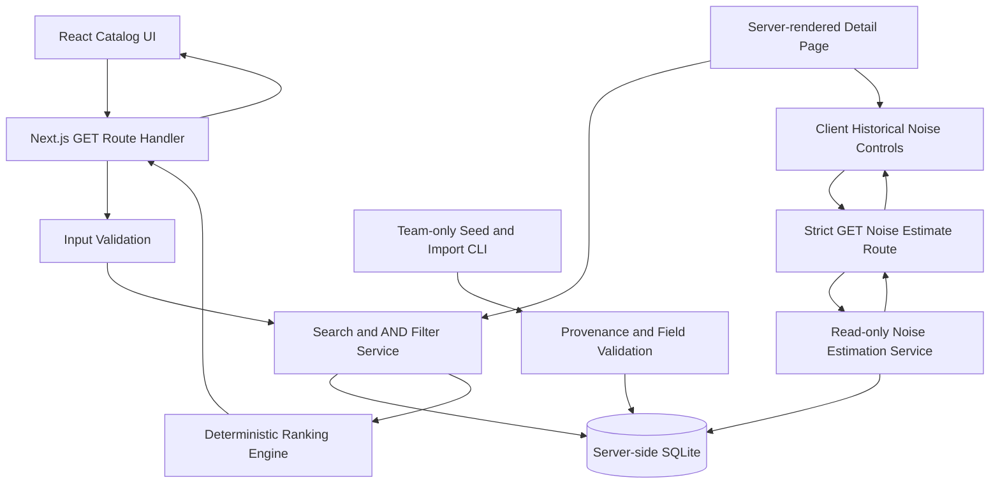
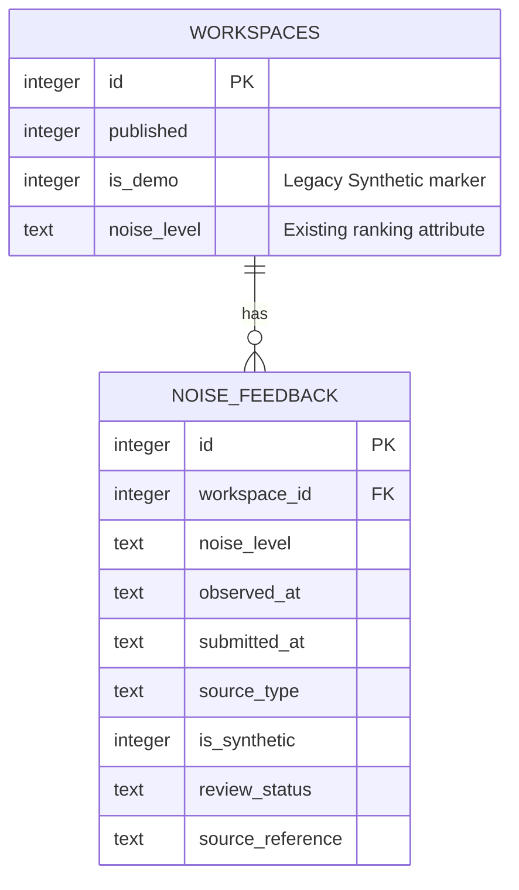

# V0.2 Architecture Notes

## Baseline

The repository's QuietCue_6_SPMP.pdf was reviewed. The implementation uses Next.js and SQLite, explainable deterministic recommendations, a safe read-only catalog, and provenance validation. The requested first release focuses on working core features; schedule dates do not block implementation. SRS v2.0 and the original ADR-001 were not supplied. These are implementation notes, not a reconstruction or replacement of the original ADR.

V0.2 preserves the V0.1 catalog, filtering, scoring, provenance display, Unknown values, freshness warnings, and cross-platform Node setup. It adds historical noise estimation using exclusively Synthetic demonstration workspaces and feedback. No real collection, investigation, human evidence review, or authenticity verification has occurred. Earlier real-dataset targets are future scope, not V0.2 acceptance requirements.

## Request Flow

The React catalog component calls the API and does not import server modules. The detail page is a Server Component that reads public records through the same catalog service. All database access remains on the Node server. Runtime connections are read-only; writes are performed only through the team CLI using transactions.

The historical panel requests a selected UTC day type/period and renders the selected estimate plus three computed overview bars. A read transaction gives the overview one consistent snapshot and reference time. There is no write, collection, moderation, or public submission path in the service. Noise estimates have no edge into the ranker: existing task scores remain based on workspace attributes alone. Bars represent computed historical means, not static decoration, live readings, or an ML prediction.

## Data Model

One workspace has zero or many feedback records. The foreign key uses `ON DELETE RESTRICT`; imports use in-place upserts rather than delete/reinsert to preserve dependencies. Feedback IDs are unique, as is `(workspace_id, observed_at, source_type)`. The composite index `(workspace_id, review_status, observed_at)` supports historical queries; separate indexes cover `observed_at` and `review_status`. The existing workspace publication index remains.

## Decisions

- Built-in Node SQLite reduces dependencies and native-module installation requirements. Node >=22.18 is required; Edge Runtime is unsupported.
- Custom CSS keeps dependencies small, with a light background, teal actions, and blue data notices.
- NULL represents unknown environment attributes; 0 means explicitly unavailable and 1 means explicitly available.
- `published` defines the public-access boundary. The preserved `is_demo` workspace marker means Synthetic; feedback independently requires explicit `is_synthetic` and `source_type`. CLI validation requires markers to agree across the relationship, and the estimation service filters sources to match the workspace, never mixing Synthetic and real feedback.
- The API validates input, executes a parameterized query, then applies scoring. SQL structure comes only from internal allowlists, never user-supplied SQL.
- `%`, `_`, and `\` are escaped for literal substring search. Case-insensitive comparison uses JavaScript Unicode lowercase conversion, not language-specific fuzzy matching.
- Lowercase names are compared in a fixed character order independent of the machine's locale, with numeric IDs breaking identical-name ties.
- Freshness uses UTC calendar-date differences: 90 days is not flagged, while 91 days is. Missing dates display Unknown.
- Search uses a short debounce and AbortController so older requests cannot overwrite newer results. The URL preserves search and filters without an account or localStorage.
- React renders data as safe text without `dangerouslySetInnerHTML`. Source links allow only HTTP(S).
- Read-only Route Handlers export only GET. Next.js returns 405 for unsupported write methods.
- There is no global loading Suspense boundary, preserving actual HTTP 404 responses for missing details. The catalog provides its own loading feedback.
- Environment coverage currently measures five environment fields. The team must supply the SRS definition before confirming the formal acceptance calculation.

## Rule Table

| Task | Verified match | Points |
| --- | --- | --- |
| Quiet Study | Quiet / outlets / Wi-Fi | 2 / 1 / 1 |
| Group Discussion | group-friendly / Moderate or Lively / Wi-Fi | 2 / 1 / 1 |
| Remote Work | Wi-Fi / outlets / Quiet or Moderate | 2 / 2 / 1 |

Unknown values earn no points. A zero score always displays `No verified task match.`. Explanations mention only attributes that actually contributed points. Demo explanations illustrate the rules and are not claims of real-world verification.

## Publication Gate

Workspace imports require every schema field, no unknown fields, valid types/enums, positive safe-integer IDs, and an explicit marker: default real format uses `is_demo = 0`, while `--synthetic` requires `is_demo = 1`. Published real records must include a description, collection method, source note, and non-future verification date. The collection method determines whether `observation_ref`, `source_url`, or both are required. The retained real template is an unpublished future format example, not a collected record.

Workspace imports validate each record within one transaction and upsert matching-marker IDs without changing `is_demo`. Duplicate batch IDs, opposite-marker conflicts, or any validation failure roll back the batch. Feedback imports validate and insert within one transaction, never upsert: existing IDs, duplicate natural keys, missing workspaces, and mismatched markers reject the entire batch. UTC timestamps accept only canonical seconds or three-digit milliseconds with `Z`, normalize to milliseconds, and must satisfy `observed_at <= submitted_at <= now`; future submissions and invalid calendar dates are rejected. Approved real feedback requires a nonblank `source_reference`, but format validation cannot prove authenticity. Future real evidence would need actual human review before approval/publication; no such review is claimed.

## Historical Estimation

The default rolling history window is 90 elapsed days, inclusive of its lower bound and reference time. Only approved feedback for the requested public workspace and matching Synthetic marker is used. Observation time chooses the exact bucket: Monday-Friday or Saturday/Sunday in UTC, then Morning `[06:00,12:00)`, Afternoon `[12:00,18:00)`, or Evening `[18:00,24:00)`. Observations before 06:00 do not enter any period. No neighboring buckets are pooled.

Quiet/Moderate/Lively map to 1/2/3. At least three samples are required; the mean maps to Quiet below 1.5, Moderate below 2.5, otherwise Lively. Confidence is count-only: 0-2 Insufficient Data, 3-4 Low Confidence, 5-9 Medium Confidence, and 10+ Higher Sample Confidence. It is not validated statistical accuracy. See [NOISE_ESTIMATION.md](NOISE_ESTIMATION.md) for metadata semantics and API details.

The strict GET endpoint defaults to `Weekday` and `Morning`, returns `{ estimate, overview, notices }`, and disallows unknown/duplicate parameters. Statuses are 400 for invalid input, 404 for absent/unpublished workspaces, 503 for generic read failures, and 405 for unsupported write methods. Responses use `no-store`; errors do not expose SQL, filesystem paths, or raw feedback.

## Synthetic Lifecycle

`db:demo` creates 12 workspaces (11 public) and 366 feedback rows, including one pending and one rejected fixture per workspace. Cloudberry (ID 10) has two approved samples in each of six exact buckets, deliberately insufficient. Other default workspaces have five approved samples per bucket. Pending/rejected fixtures never contribute.

`db:synthetic` replaces Synthetic feedback for the current ordered Synthetic workspace list without changing workspace records. `--clear` deletes Synthetic feedback then Synthetic workspaces; retained dependencies trigger foreign-key RESTRICT and atomic rollback, never deletion of real records. Both lifecycle commands accept optional seed/reference time; deterministic output requires the same seed, reference time, and ordered workspace list. The generator uses a 32-bit PRNG and observations up to roughly a month old, not real measurements. Fixed fixtures eventually age out; regenerate for a current demo. CLI usage is in [../README.md](../README.md).

## Evidence Boundaries

Local verification so far includes 44 passing Node tests and eight passing focused historical-noise browser checks. Full end-to-end verification is recorded separately in [VERIFICATION.md](VERIFICATION.md), without a full-suite result claimed here. Desktop/mobile-sized Chromium is not real-device coverage. No formal load study, human PR review, usability study, Windows hardware run, or remote CI pass is claimed. No dedicated SAST is configured, and Semgrep/CodeQL are not installed locally; lint and dependency audits do not establish SAST coverage.