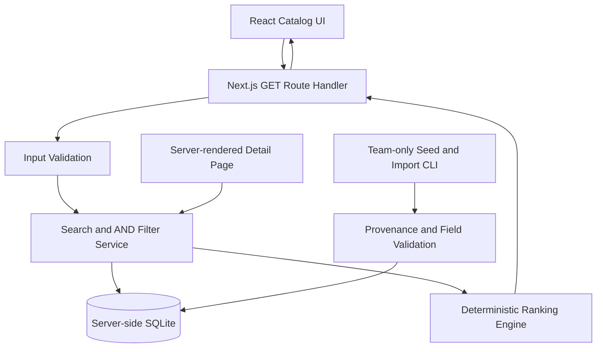

# V0.1 Architecture Notes

## Baseline

The repository's QuietCue_6_SPMP.pdf was reviewed. The implementation uses Next.js and SQLite, explainable deterministic recommendations, a safe read-only catalog, and provenance validation. The requested first release focuses on working core features; schedule dates do not block implementation. SRS v2.0 and the original ADR-001 were not supplied. These are implementation notes, not a reconstruction or replacement of the original ADR.

## Request Flow

The React catalog component calls the API and does not import server modules. The detail page is a Server Component that reads public records through the same catalog service. All database access remains on the Node server. Runtime connections are read-only; writes are performed only through the team CLI using transactions.

## Decisions

- Built-in Node SQLite reduces dependencies and native-module installation requirements. Node >=22.18 is required; Edge Runtime is unsupported.
- Custom CSS keeps dependencies small, with a light background, teal actions, and blue data notices.
- NULL represents unknown environment attributes; 0 means explicitly unavailable and 1 means explicitly available.
- `published` defines the public-access boundary, while `is_demo` separates fictional records from real-data provenance validation.
- The API validates input, executes a parameterized query, then applies scoring. SQL structure comes only from internal allowlists, never user-supplied SQL.
- `%`, `_`, and `\` are escaped for literal substring search. Case-insensitive comparison uses JavaScript Unicode lowercase conversion, not language-specific fuzzy matching.
- Lowercase names are compared in a fixed character order independent of the machine's locale, with numeric IDs breaking identical-name ties.
- Freshness uses UTC calendar-date differences: 90 days is not flagged, while 91 days is. Missing dates display Unknown.
- Search uses a short debounce and AbortController so older requests cannot overwrite newer results. The URL preserves search and filters without an account or localStorage.
- React renders data as safe text without `dangerouslySetInnerHTML`. Source links allow only HTTP(S).
- Read-only Route Handlers export only GET. Next.js returns 405 for unsupported write methods.
- There is no global loading Suspense boundary, preserving actual HTTP 404 responses for missing details. The catalog provides its own loading feedback.
- Environment coverage currently measures five environment fields. The team must supply the SRS definition before confirming the formal acceptance calculation.

## Rule Table

| Task | Verified match | Points |
| --- | --- | --- |
| Quiet Study | Quiet / outlets / Wi-Fi | 2 / 1 / 1 |
| Group Discussion | group-friendly / Moderate or Lively / Wi-Fi | 2 / 1 / 1 |
| Remote Work | Wi-Fi / outlets / Quiet or Moderate | 2 / 2 / 1 |

Unknown values earn no points. A zero score always displays `No verified task match.`. Explanations mention only attributes that actually contributed points. Demo explanations illustrate the rules and are not claims of real-world verification.

## Publication Gate

Real-data imports require every schema field, valid types and enums, positive integer IDs, and `is_demo = 0`. Published records must include a description and provenance date. The collection method determines whether `observation_ref`, `source_url`, or both are required. A transaction begins only after the entire batch passes validation, and conflicts roll back the batch. Template drafts remain unpublished. Field validation does not replace human evidence review.